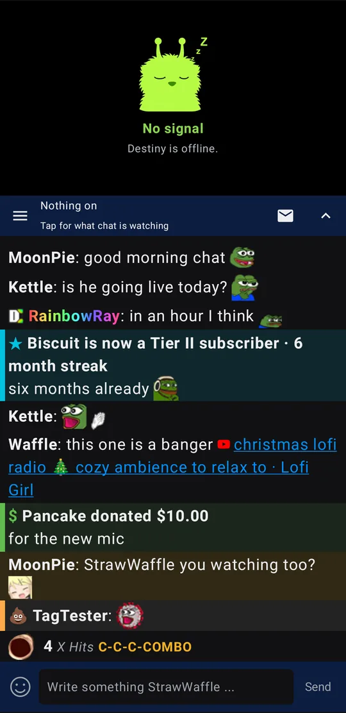
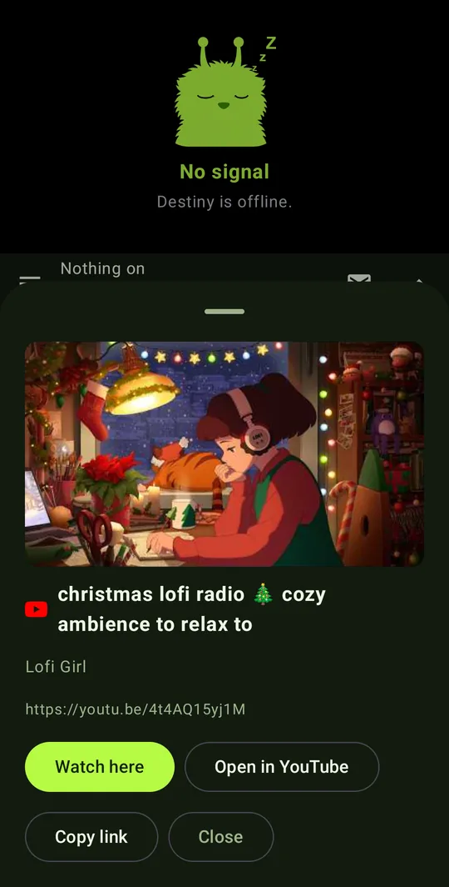
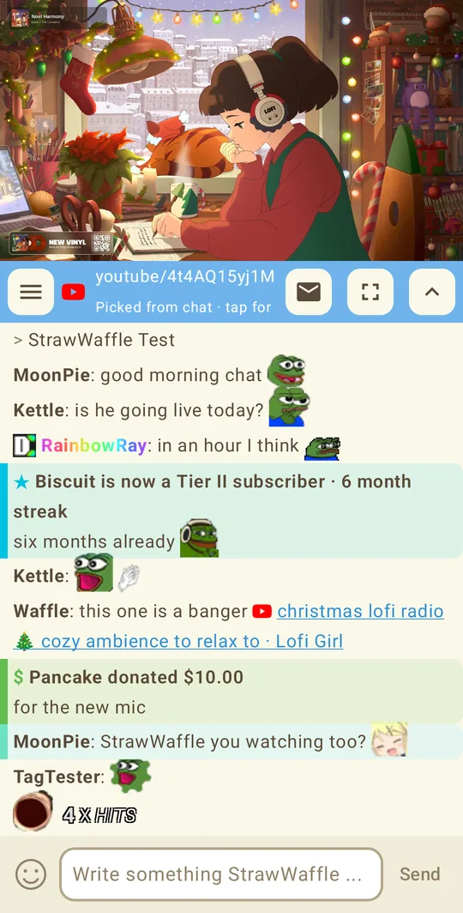
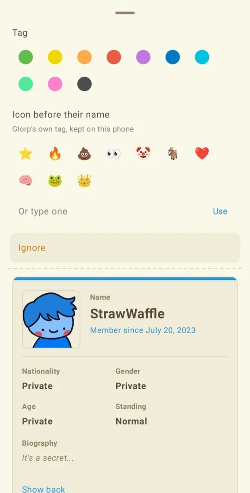

# Glorp

Glorp is an unofficial destiny.gg app for Android. It does what the site's
chat does, plays bigscreen's streams in Android's own video player, and adds a
few things the site doesn't have. Chat only stays connected while the app is
on screen, and only the rows you can see get drawn, so it's light on battery
and memory.

**[strawwaffle.dev/glorp](https://strawwaffle.dev/glorp/)** ·
**[Download the latest release](https://github.com/StrawWaffle/glorp/releases/latest)**

Glorp is a community project. Neither destiny.gg nor Destiny makes it or is
affiliated with it.

## What it does

### Chat, as on the site

Glorp follows chat-gui, destiny.gg's own chat code, so chat looks and behaves
the way it does in a browser.

- Emotes move the way they do on the site, with their colour changes, glows
  and the extras drawn over them, like BibleThump's tears and GSN's dolphins.
  Glorp reads the site's own emote stylesheet, and a test compares its frames
  with the site's in a browser. Combos count up and end with C-C-C-COMBO,
  over the splat from 10 hits. Flairs colour names, and Tier 5 names get the
  moving rainbow.
- Mentions, highlight words, tags with notes, the ignore list and timestamps
  all work.
- Whispers have their own conversations, with history.
- You can vote in polls. The pinned message and spotlighted messages show.
- Subscriptions, gifted subs, donations, deaths, posts from X and the
  Vestaboard show up in chat.
- Messages from muted and banned users get censored, NSFW and NSFL messages
  can be hidden, and mod notices show.
- The site's commands work, `/stalk`, `/mentions`, `/tag` and `/maxlines`
  included. The input suggests emotes, names and commands as you type.
- Tapping a name, the sender's or one in a message, focuses chat on that
  person, as on the site: everything not from them or naming them fades until
  you tap it again. Holding a name opens their menu: mention, whisper, their
  recent messages, highlight, tags, and at the bottom their membership card
  from their profile page (photo, team, tier, standing and biography, and on
  the back their signature).
- Tapping a link shows its preview. Tapping an emote shows who made it and
  lets you favourite it. Hold the emote there to see what it does when
  pointed at on the site. The eye button's same-stream dimming is there too.
- Signed in with cookies, your chat settings follow your account and the site
  sees what you're watching.

### Better on a phone

- Kick, Twitch, YouTube, Rumble and AngelThump play in Android's own player, live and
  recorded. It has a quality menu, picture in picture and sound with the
  screen off. On Kick it sits about 4 seconds behind live. Other platforms use
  their web player.
- Notifications tell you when Destiny goes live, when someone mentions you,
  and when you get a whisper, without chat open. Mentions come from
  polecat.me's chat logs, so they work with any sign-in, as often as every
  5 minutes.
- Before you send, Glorp warns you if the message would hit a nuke, mutelinks
  or a banned phrase. While a nuke or mutelinks is on, a warning triangle
  sits at the top left of chat; tap it to see what. The lists come from
  vyneer.me, as they did for the d.gg utilities userscript.
- Chat log search from rustlesearch.dev, every message that ever mentioned
  you from polecat.me, the poll archive and movie nights are built in.
  YouTube and Rumble links show their titles.
- Busy chat stays smooth. Glorp prepares new messages away from the screen's
  own work and lets a flood in a few rows at a time.
- Glorp updates itself from its releases. Menu → Report a problem opens a
  GitHub issue with the version, phone and log already filled in.

### Glorp's own

Five themes: Glorp's green in dark and light, destiny.gg's own, and Aerith's
light and dark with her round buttons and glowing input. Emoji name icons that
only you see. Chat from other streams dimmed or hidden. Your choice of text
size and font. Your latest mention stays at the top until you close it, and
your own alert words warn you before sending. You pick which platform plays
Destiny when he's live on several. Settings → Sync keeps all of this the same
on your other phones. Test versions, which install as *Glorp Probe*, are there
for anyone who wants to try what's next.

### On a computer, if you want it

Glorp is a phone app, and the app is where to start. If you also use
destiny.gg's chat in a browser, the
[Glorp userscript](https://strawwaffle.dev/glorp/userscript/glorp.user.js)
brings a few of Glorp's own things there: the themes, name icons, hiding
other streams' chat, your latest mention kept in view, polecat.me's mentions,
rustlesearch.dev's log search, and your icon and chat's tag in each name's
menu. It does much less than the
app and needs Violentmonkey. Hidden phrases, hidden flairs and alert words
came to Glorp from the d.gg utilities userscript, so on a computer that
script does them.

Settings → Sync keeps Glorp's own settings the same in the app, on other
phones and in the userscript. The sync service only stores them encrypted
with a key made from your sync code, which never leaves your devices. Its
code is in [`sync`](sync).

What's still to come is in [docs/PLAN.md](docs/PLAN.md).

## Install

Download the APK from the [latest release](https://github.com/StrawWaffle/glorp/releases/latest)
and open it, or add this repository to [Obtainium](https://obtainium.imranr.dev/).
The first time, Android asks you to let your browser install apps. After
that, Glorp offers new releases at the top of its menu.

It needs Android 8 or newer.

## Signing in

destiny.gg's login page can't run inside an app, because Twitch, Kick and
Google block sign-in there. Glorp signs in two other ways.

- **From a computer.** This unlocks everything. Open
  [Glorp's sign-in page](https://strawwaffle.dev/glorp/signin/) on a
  computer that's signed in to destiny.gg, copy the two values it asks for
  from the browser, and scan the code it shows with Glorp. The page sends
  nothing anywhere. Its code is in [`pages/signin`](pages/signin). With
  Violentmonkey, or Tampermonkey's beta, the
  [Glorp userscript](https://strawwaffle.dev/glorp/userscript/glorp.user.js)
  reads the two values for you and shows the code on destiny.gg itself.
- **A login key.** This covers chat and whispers. Create one on your
  account's developer page and paste it into Glorp.

Glorp keeps the login on the phone, encrypted with a key from Android's
keystore.

## Problems and ideas

In Glorp, Menu → Report a problem writes a GitHub issue with the details
filled in, or [open one here](https://github.com/StrawWaffle/glorp/issues/new/choose).
No GitHub account? Whisper StrawWaffle in destiny.gg chat.

## Thanks

- [rustlesearch.dev](https://rustlesearch.dev/), and Mitch's
  [mitchdev.net](https://mitchdev.net/dgg/) and
  [dinkdonk.mov](https://dinkdonk.mov/), whose data the community screens
  show. vyneer.me, whose lists the warnings use. polecat.me, whose chat logs
  the mentions come from.
- The "AngelThump Edge Picker" userscript. Glorp picks between AngelThump's
  servers the way it does.
- [FUTO's Grayjay](https://grayjay.app/). YouTube plays through Grayjay's
  YouTube plugin, run by code adapted from Grayjay.
- Aerith, whose themes for the site the Aerith themes copy.

## Licence

Glorp's own code is under [PolyForm Noncommercial 1.0.0](LICENSE.md). You can
use, change and share it for anything non-commercial. The `grayjay/` module
holds code adapted from Grayjay, under FUTO's
[Source First License 1.1](grayjay/LICENSE.md). The app's font, Roboto, is
under Apache 2.0. The website's fonts, Nunito and Gaegu, are under the SIL
Open Font License.

## In this repository

- `androidApp/`, `shared/` and `grayjay/` hold the app, in Kotlin
  Multiplatform.
- `pages/` holds the website and the computer sign-in page.
  `.github/workflows/pages.yml` publishes it to GitHub Pages.
- `server/` and `compose.yaml` run a small service that watches destiny.gg
  chat, so the app can notify mentions without the site's login. See
  [server/README.md](server/README.md) and `.env.example`.
