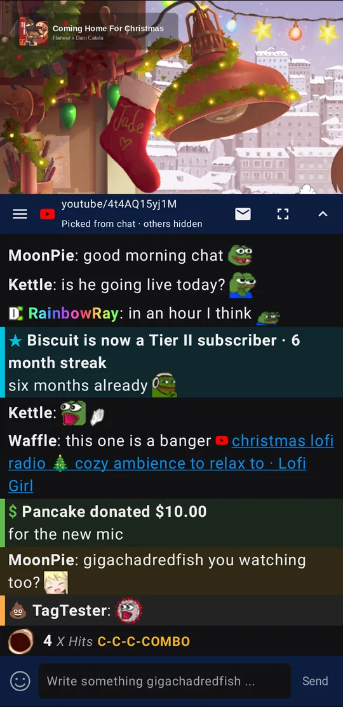

# Glorp

An unofficial destiny.gg app for Android: everything the site's chat does,
bigscreen's streams in a native video player, and a few things of its own,
made to go easy on memory and battery.

**[strawwaffle.github.io/glorp](https://strawwaffle.github.io/glorp/)** ·
**[Download the latest release](https://github.com/StrawWaffle/glorp/releases/latest)**

Glorp is a community project. It is not made by or affiliated with destiny.gg
or Destiny.

## What it does

**Chat, as on the site.** Glorp follows destiny.gg's own chat code (chat-gui):

- emotes, animated, with combos and their effects next to each other;
  flairs and name colours, Tier 5's moving rainbow included;
- mentions, highlight words, tags with notes, the ignore list, timestamps;
- whispers with their conversations and history;
- polls you can vote in, the pinned message, spotlighted messages;
- subscriptions, gifted subs, donations, deaths, posts from X and the
  Vestaboard;
- censoring of muted and banned users, NSFW and NSFL hiding, mod notices;
- the site's commands (`/stalk`, `/mentions`, `/tag`, `/maxlines` and the
  rest), with emote, name and command suggestions as you type;
- link previews, emote cards and favourite emotes, the eye button's
  same-stream dimming;
- your chat settings follow your account, and the site sees what you're
  watching, when you sign in with cookies.

**Better on a phone.**

- Kick, Twitch (live, VODs, clips), YouTube (live and recordings) and
  AngelThump in Android's own player: a quality menu, picture in picture,
  sound with the screen off, and a few seconds from live. Other platforms use
  their web player.
- Notifications when Destiny goes live, when you're mentioned, and for
  whispers, without chat open.
- Warnings before a message would hit a nuke, mutelinks or a banned phrase
  (vyneer.me's lists, as the d.gg utilities userscript used).
- Chat log search (rustlesearch.dev), the poll archive and movie nights,
  built in; titles for YouTube and Rumble links.
- Updates itself from its releases; Menu → Report a problem writes a GitHub
  issue with the version, phone and log filled in.

**Glorp's own.** Themes (Glorp's, and Aerith's light and dark), emoji name
icons, hiding chat from other streams, text size and font, a sticky latest
mention, your own alert words, a preferred platform for Destiny's stream, and
test versions (as *Glorp Probe*) for anyone who wants to try what's next.

Still to come is in [docs/PLAN.md](docs/PLAN.md).

## Install

Download the APK from the [latest release](https://github.com/StrawWaffle/glorp/releases/latest),
or add this repository to [Obtainium](https://obtainium.imranr.dev/). Glorp
then checks for new releases itself and offers them at the top of its menu.
The first time, Android asks you to let your browser install apps.

Android 8 or newer.

## Signing in

destiny.gg's login page can't run inside an app (Twitch, Kick and Google block
it), so Glorp signs in two ways:

- **From a computer** (everything): open
  [Glorp's sign-in page](https://strawwaffle.github.io/glorp/signin/) on a
  computer signed in to destiny.gg, copy two values from the browser as it
  shows, and scan the code it makes with Glorp. The page sends nothing
  anywhere; its code is in [`pages/signin`](pages/signin).
- **A login key** (chat and whispers): create one on your account's developer
  page and paste it into Glorp.

Logins are kept on the phone, encrypted with a key in Android's keystore.

## Thanks

- [rustlesearch.dev](https://rustlesearch.dev/), [mitchdev.net](https://mitchdev.net/dgg/)
  and [dinkdonk.mov](https://dinkdonk.mov/) (both by Mitch), whose data the
  community screens show, and vyneer.me, whose lists the warnings use.
- The "AngelThump Edge Picker" userscript, whose way of choosing between
  AngelThump's servers Glorp follows.
- [FUTO's Grayjay](https://grayjay.app/): YouTube plays through Grayjay's
  YouTube plugin, run by code adapted from Grayjay.
- Aerith, whose themes for the site Glorp's Aerith themes are taken from.

## Licence

Glorp's own code: [PolyForm Noncommercial 1.0.0](LICENSE.md), free to use,
change and share for anything non-commercial. The `grayjay/` module holds
code adapted from Grayjay and is under FUTO's
[Source First License 1.1](grayjay/LICENSE.md). The fonts are Roboto (Apache
2.0) in the app, and Nunito and Gaegu (SIL Open Font License) on the website.

## In this repository

- `androidApp/`, `shared/`, `grayjay/`: the app (Kotlin Multiplatform).
- `pages/`: the website and the computer sign-in page, published to GitHub
  Pages by `.github/workflows/pages.yml`.
- `server/` and `compose.yaml`: a small service that watches destiny.gg chat
  so the app can notify mentions without the site's login. See
  [server/README.md](server/README.md) and `.env.example`.
